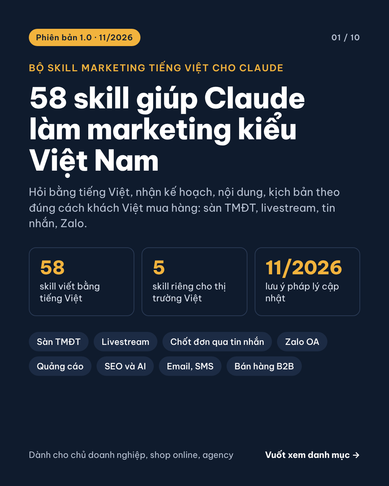
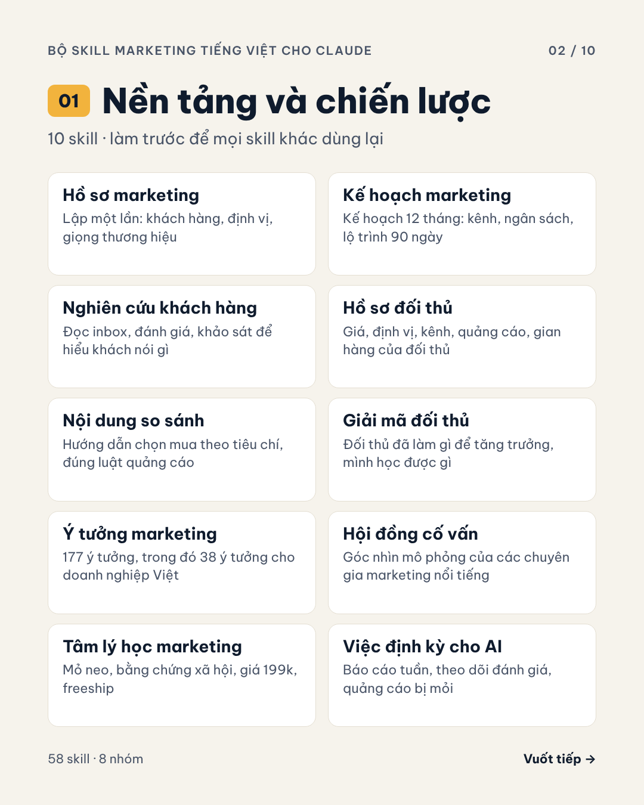
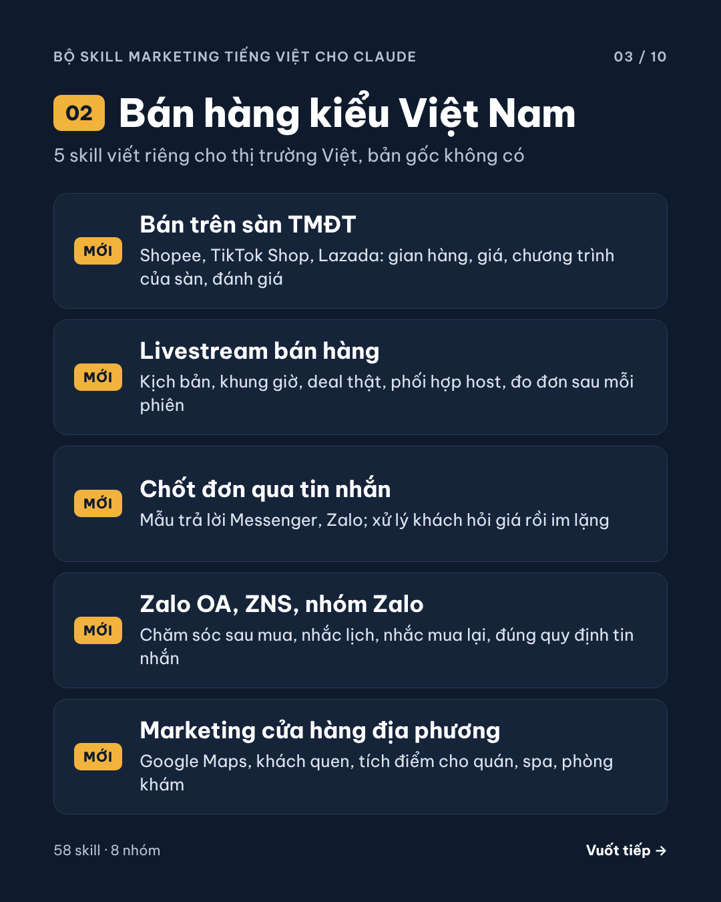
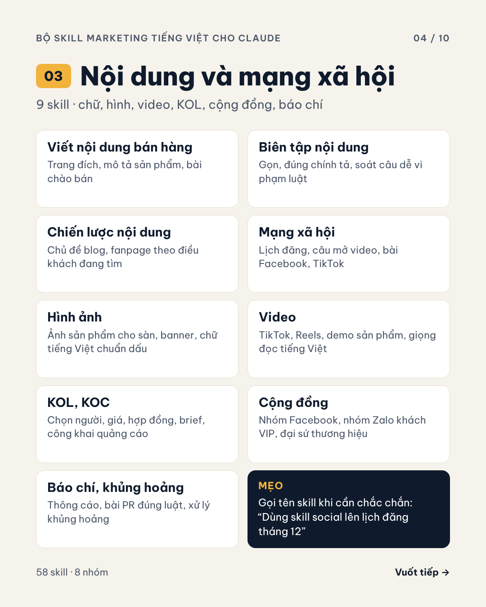
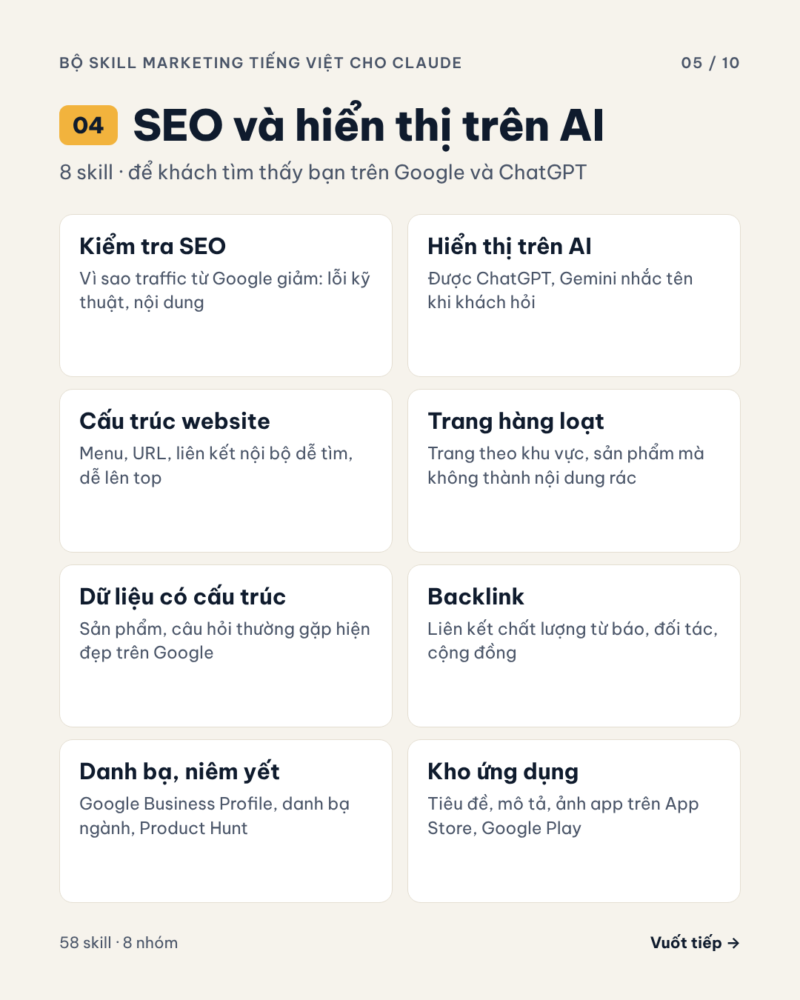
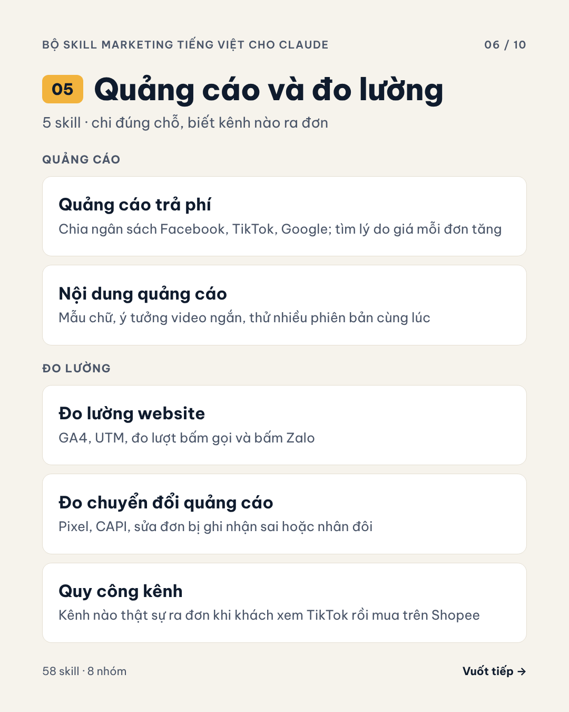
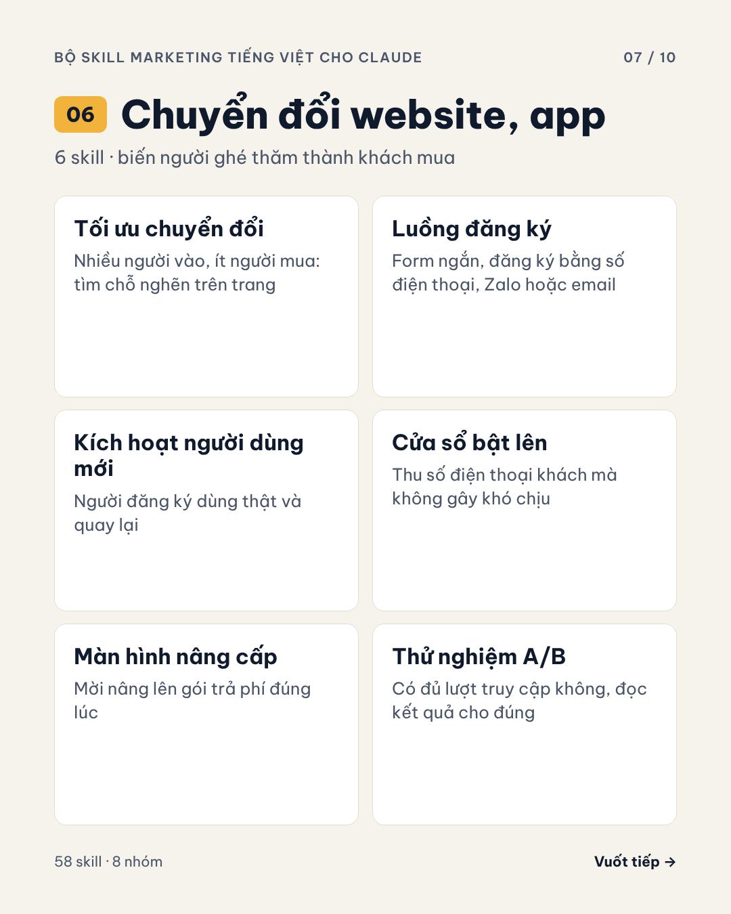
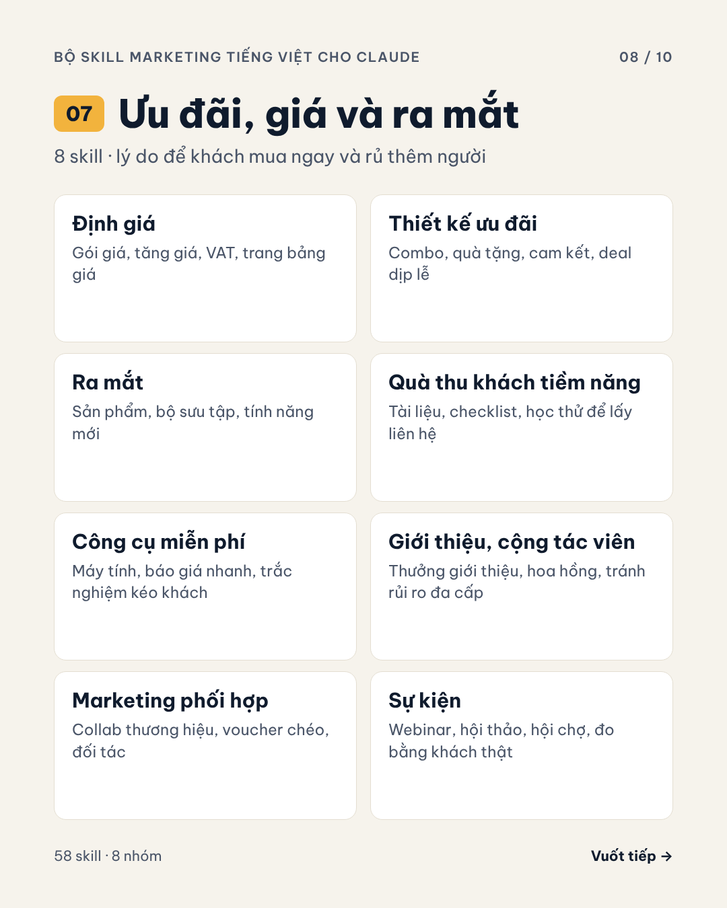
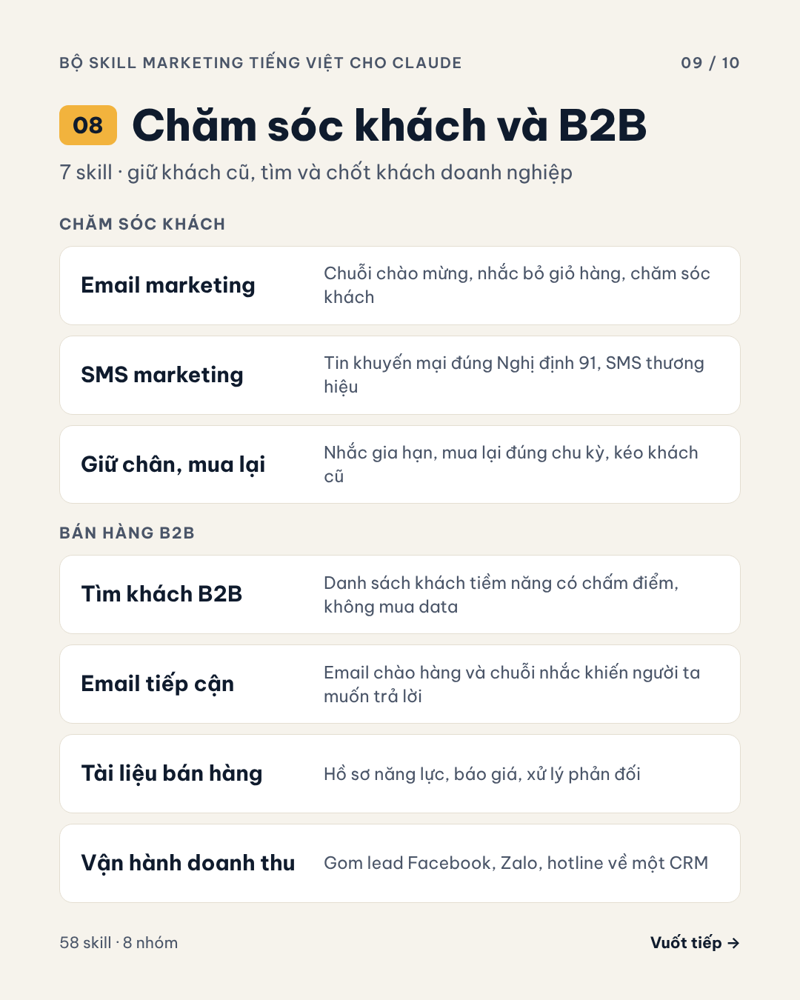

<p align="center"></p>

# Skill Agentic Marketing

58 skill giúp Claude làm marketing theo cách doanh nghiệp Việt Nam thật sự bán hàng: sàn TMĐT, livestream, chốt đơn qua tin nhắn, Zalo, cửa hàng địa phương, quảng cáo, SEO, email và bán hàng B2B. Hỏi bằng tiếng Việt, nhận kế hoạch, nội dung, kịch bản dùng được cho doanh nghiệp của bạn.

**Phiên bản 1.0.1** · cập nhật 17/11/2026 · dùng với app Claude (web, desktop) và Claude Code

## Cài nhanh

**Claude Code:**

```
/plugin marketplace add ongtri44/skill-agentic-marketing
/plugin install skill-agentic-marketing@skill-agentic-marketing
```

**App Claude (web, desktop):** vào thư mục [`claude-app/`](claude-app), tải tệp ZIP của skill cần dùng (bắt đầu với `product-marketing.zip`), rồi trong Claude chọn Customize → Skills → "+" → Upload a skill. Cần tài khoản Claude có hỗ trợ Skills và bật thực thi mã.

Hướng dẫn đầy đủ, kèm bộ skill gợi ý theo ngành: [HUONG-DAN-CAI-DAT.md](HUONG-DAN-CAI-DAT.md).

## Vì sao cần bộ này

Hỏi Claude về marketing, bạn thường nhận lời khuyên viết cho thị trường Mỹ: email list, Product Hunt, thẻ tín dụng tự gia hạn. Trong khi khách của bạn hỏi giá qua Zalo, săn sale 12/12 trên Shopee, xem livestream rồi chốt đơn COD.

Bộ skill này cho Claude biết cách làm việc ở thị trường Việt Nam: kênh nào, xưng hô ra sao, quy định nào phải tránh, số liệu đo thế nào. Bạn lập Hồ sơ marketing một lần, các lần sau Claude dùng lại, không hỏi lại từ đầu.

## Có gì bên trong

| Thành phần | Nội dung |
|---|---|
| **53 skill Việt hóa** | Toàn bộ bộ skill marketing gốc, viết lại bằng tiếng Việt với ví dụ, kênh, đơn vị tiền tệ của Việt Nam |
| **5 skill mới cho Việt Nam** | Bán trên sàn TMĐT, livestream bán hàng, chốt đơn qua tin nhắn, Zalo OA/ZNS, marketing cửa hàng địa phương |
| **Lưu ý pháp lý cập nhật 11/2026** | Luật Quảng cáo sửa đổi, Luật TMĐT 2025, Luật Bảo vệ dữ liệu cá nhân, Nghị định 91 về tin nhắn quảng cáo, khuyến mại, báo chí |
| **38 ý tưởng cho SME Việt** | Shop online, cửa hàng, F&B, spa, giáo dục, B2B |
| **Hai cách cài** | Plugin Claude Code (thư mục [`plugin/`](plugin)); mỗi skill một tệp ZIP cho app Claude ([`claude-app/`](claude-app)) |
| **Câu lệnh kiểm tra** | 116 câu lệnh tiếng Việt trong [`evals/prompts-vi.json`](evals/prompts-vi.json) |

## Danh mục 58 skill

<p align="center"></p>

<table>
<tr><td width="50%"></td><td width="50%"></td></tr>
<tr><td width="50%"></td><td width="50%"></td></tr>
<tr><td width="50%"></td><td width="50%"></td></tr>
<tr><td width="50%"></td><td width="50%"></td></tr>
</table>

<details>
<summary><b>Xem danh mục dạng chữ (tìm kiếm được)</b></summary>

#### Nền tảng và chiến lược (10)

| Skill | Gọi tên | Dùng khi |
|---|---|---|
| Hồ sơ marketing (nền tảng cho mọi skill) | `product-marketing` | Lập Hồ sơ marketing: sản phẩm, khách hàng, định vị, đối thủ, giọng thương hiệu, xưng hô, kênh bán. Dùng đầu tiên cho dự án mới; các skill khác đọc hồ sơ này. |
| Kế hoạch marketing | `marketing-plan` | Kế hoạch marketing 12 tháng theo AARRR cho doanh nghiệp hoặc khách hàng: hiện trạng, kênh, ngân sách, đội ngũ, lộ trình 90 ngày, đo lường, quyết định còn mở. |
| Nghiên cứu khách hàng | `customer-research` | Nghiên cứu khách hàng: phân tích inbox, đánh giá sàn, khảo sát, phỏng vấn; tiếng nói khách hàng, JTBD, chân dung khách, mức tin cậy của kết luận. |
| Hồ sơ đối thủ | `competitor-profiling` | Hồ sơ đối thủ có ngày tháng: định vị, giá, tính năng, đánh giá, SEO, quảng cáo, gian hàng trên sàn; tách dữ kiện quan sát khỏi suy luận. |
| Nội dung so sánh và chọn mua | `competitors` | Trang so sánh, hướng dẫn chọn theo tiêu chí, trang thay thế; chế độ Việt Nam (luật cấm so sánh trực tiếp) và quốc tế; tuyên bố có ngày, rà soát trang cũ. |
| Giải mã cách đối thủ tăng trưởng | `reverse-engineer-marketing` | Giải mã cách đối thủ tăng trưởng: nhật ký nước đi có ngày, đường traffic, thư viện quảng cáo, tuyển dụng, đánh giá, gian hàng sàn, điểm yếu, nước đi nên học. |
| Ý tưởng marketing | `marketing-ideas` | Ý tưởng marketing: 139 ý tưởng phần mềm và 38 ý tưởng cho SME Việt (shop online, cửa hàng, F&B, spa, B2B), chọn theo giai đoạn, ngân sách, mục tiêu. |
| Hội đồng cố vấn mô phỏng | `marketing-council` | Hội đồng cố vấn mô phỏng: Godin, Ogilvy, Dunford, Sharp, Hormozi… cho ý kiến dựa trên khung đã công bố, chỉ ra bất đồng, khuyến nghị cho thị trường Việt. |
| Tâm lý học marketing | `marketing-psychology` | Tâm lý học marketing: thiên kiến, mô hình tư duy, mỏ neo, bằng chứng xã hội, khan hiếm thật, sợ mất mát, tâm lý giá 199k, freeship, giá gạch đúng luật. |
| Việc marketing định kỳ cho AI | `marketing-loops` | Việc marketing định kỳ cho AI chạy theo lịch: kiểm tra SEO, quảng cáo mỏi, khách sắp rời, đánh giá trên sàn, báo cáo tuần; nhịp, trạng thái, điểm dừng. |

#### Bán hàng kiểu Việt Nam (skill mới) (5)

| Skill | Gọi tên | Dùng khi |
|---|---|---|
| Bán trên sàn TMĐT **(mới)** | `marketplaces` | Bán trên Shopee, TikTok Shop, Lazada, Tiki: chọn sàn, tối ưu trang sản phẩm, tính lãi sau phí sàn, quảng cáo trong sàn, ngày sale, đánh giá, Mall. |
| Livestream bán hàng **(mới)** | `livestream` | Livestream bán hàng TikTok Shop, Shopee Live, Facebook: lịch phát, kịch bản theo vòng, deal, vai trò, thuê host/KOC, đo lường, Luật TMĐT 2025. |
| Chốt đơn qua tin nhắn **(mới)** | `chat-selling` | Bán hàng qua Messenger, Zalo, inbox sàn: kịch bản tư vấn tới chốt đơn, xử lý từ chối, xác nhận đơn COD giảm boom hàng, trả lời tự động, chỉ số. |
| Zalo OA, ZNS, nhóm Zalo **(mới)** | `zalo` | Zalo cho doanh nghiệp: Zalo OA, tin truyền thông, ZNS theo số điện thoại, Zalo Ads, Mini App, nhóm Zalo, chăm sóc sau mua, tránh spam và khóa tài khoản. |
| Marketing cửa hàng địa phương **(mới)** | `local-marketing` | Marketing cửa hàng có địa chỉ (quán ăn, spa, phòng khám, gym, chuỗi): Google Maps, đánh giá, nội dung địa phương, app giao đồ ăn, khai trương, khách quen. |

#### Nội dung, mạng xã hội và hình ảnh (9)

| Skill | Gọi tên | Dùng khi |
|---|---|---|
| Viết nội dung bán hàng | `copywriting` | Viết chữ cho trang chủ, landing page, trang giá, trang sản phẩm; chọn tiêu đề và thông điệp. Chẩn đoán trước khi viết, tuyên bố phải chứng minh được, không văn kiểu AI. |
| Biên tập nội dung | `copy-editing` | Biên tập chữ có sẵn: bảy lượt quét, bỏ văn kiểu AI và văn dịch, sửa xưng hô, thêm bằng chứng, sửa một câu thì chỉ sửa câu đó, làm mới nội dung cũ. |
| Chiến lược nội dung | `content-strategy` | Chiến lược nội dung: trụ cột, cụm chủ đề, chủ đề nào ưu tiên, lịch biên tập, từ khóa theo giai đoạn mua, phân phối nội dung đa kênh. |
| Mạng xã hội | `social` | Nội dung mạng xã hội cho Facebook, TikTok, Instagram, YouTube, LinkedIn: trụ cột, hook, video ngắn, carousel, lịch đăng, tái sử dụng nội dung, không văn kiểu AI. |
| Hình ảnh marketing | `image` | Hình ảnh marketing: ảnh sản phẩm cho sàn, ảnh mạng xã hội, banner, mockup, ảnh OG; tạo bằng AI hay thiết kế; chữ tiếng Việt có dấu; tối ưu dung lượng. |
| Video marketing | `video` | Làm video marketing: chọn quay thật, avatar AI, video AI hay lập trình; TikTok, Reels, Shorts; giọng đọc và phụ đề tiếng Việt; demo sản phẩm; bản quyền nhạc. |
| KOL, KOC, nhà sáng tạo | `influencer-marketing` | Hợp tác KOL, KOC, nhà sáng tạo, đại sứ: sàng lọc, giá, hợp đồng, quyền dùng nội dung, brief, affiliate TikTok Shop, công khai quảng cáo theo luật, đo ROI. |
| Cộng đồng | `community-marketing` | Xây và phát triển cộng đồng: nhóm Facebook, Zalo, Discord, diễn đàn; bản sắc, nghi thức, thành viên mới, đại sứ, chỉ số sức khỏe cộng đồng. |
| Quan hệ báo chí, khủng hoảng | `public-relations` | Lên báo và xử lý truyền thông: thư mời phóng viên, thông cáo báo chí, bám tin nóng, bài PR trả phí đúng luật, khủng hoảng, trang báo chí, chuẩn bị podcast. |

#### Tìm kiếm (SEO) và hiển thị trên AI (8)

| Skill | Gọi tên | Dùng khi |
|---|---|---|
| Kiểm tra SEO | `seo-audit` | Kiểm tra SEO: vì sao traffic giảm, trang không lên top, lập chỉ mục, canonical, hreflang, tốc độ, tiêu đề, on-page, URL tiếng Việt, SEO địa phương. |
| Hiển thị trên câu trả lời AI | `ai-seo` | Được ChatGPT, Gemini, Google AI Overviews trích dẫn và giới thiệu: kiểm tra độ hiện diện, nội dung dễ trích, bot AI, llms.txt, pricing.md, theo dõi. |
| Cấu trúc website | `site-architecture` | Cấu trúc website: cần trang nào, phân cấp, menu, URL tiếng Việt không dấu, liên kết nội bộ, trang chi nhánh, chuyển đổi nền tảng và chuyển hướng. |
| SEO lập trình (trang hàng loạt) | `programmatic-seo` | Trang SEO số lượng lớn từ mẫu và dữ liệu: theo địa điểm, đối tượng, tích hợp, mẫu biểu, thuật ngữ; mỗi trang phải hữu ích, tránh nội dung mỏng. |
| Dữ liệu có cấu trúc | `schema` | Dữ liệu có cấu trúc JSON-LD: Product giá VND, LocalBusiness, Article, Breadcrumb, Event; loại nào Google còn hỗ trợ, kiểm tra và sửa lỗi Search Console. |
| Xây dựng backlink | `link-building` | Backlink và nhắc tên giúp lên top và được AI trích: khoảng trống link, thu hồi nhắc tên, danh sách top, bài khách mời, rủi ro mua backlink báo, PBN. |
| Danh bạ và nền tảng niêm yết | `directory-submissions` | Đăng danh bạ và nền tảng niêm yết: Google Business Profile, danh bạ doanh nghiệp, Product Hunt, G2, danh bạ AI/SaaS/MCP, đánh giá, kiểm tra backlink. |
| Tối ưu kho ứng dụng | `aso` | Tối ưu trang ứng dụng App Store, Google Play: tên, từ khóa tiếng Việt, ảnh chụp màn hình, mô tả, đánh giá, chấm điểm và so sánh với ứng dụng đối thủ. |

#### Quảng cáo trả phí (2)

| Skill | Gọi tên | Dùng khi |
|---|---|---|
| Quảng cáo trả phí | `ads` | Quảng cáo trả phí Meta, Google, TikTok, Zalo, LinkedIn: chọn kênh, ngân sách, quảng cáo tin nhắn, ROAS thật với COD, tối ưu, tiếp thị lại, kiểm toán tài khoản. |
| Nội dung quảng cáo | `ad-creative` | Creative quảng cáo: tiêu đề, chữ chính, biến thể theo góc, ý tưởng ảnh tĩnh và video, lặp từ số liệu, giới hạn ký tự từng nền tảng, giả thuyết thử nghiệm. |

#### Chuyển đổi trên website và sản phẩm (6)

| Skill | Gọi tên | Dùng khi |
|---|---|---|
| Tối ưu chuyển đổi trang | `cro` | Tăng chuyển đổi cho landing page, trang giá, trang sản phẩm, form: chẩn đoán vì sao trang không ra đơn, sửa gì trước, thêm hay bớt trường, ý tưởng thử nghiệm. |
| Luồng đăng ký | `signup` | Tối ưu luồng đăng ký, dùng thử, tạo tài khoản: bớt trường, OTP số điện thoại, đăng nhập Google/Zalo, có nên bắt nhập thẻ, vì sao người dùng bỏ dở. |
| Onboarding, kích hoạt | `onboarding` | Onboarding và kích hoạt người dùng mới: khoảnh khắc aha, buổi dùng đầu tiên, checklist, màn hình trống, tin nhắc, vì sao người dùng không ở lại. |
| Cửa sổ bật lên, form | `popups` | Popup, khung trượt, banner: khi nào hiện, thu số điện thoại/email/Zalo, mã giảm đơn đầu, popup khi sắp rời trang, không gây phiền, đúng quy định dữ liệu. |
| Màn hình nâng cấp | `paywalls` | Paywall và màn hình nâng cấp trong app/phần mềm: khóa tính năng, hết hạn mức, hết dùng thử, thời điểm mời trả phí, thanh toán quen thuộc với khách Việt. |
| Thử nghiệm A/B | `ab-testing` | Thử nghiệm A/B: giả thuyết, cỡ mẫu, thời gian, đọc kết quả, khi nào dừng, thử khi traffic ít, tránh ngày sale lớn, danh sách thử nghiệm ICE. |

#### Ưu đãi, giá và ra mắt (8)

| Skill | Gọi tên | Dùng khi |
|---|---|---|
| Định giá, gói giá | `pricing` | Định giá và đóng gói: bán giá bao nhiêu, gói giá, đơn vị tính giá, dùng thử, tăng giá và chuyển khách cũ, trang bảng giá, VAT, giá bán lẻ và combo. |
| Thiết kế ưu đãi | `offers` | Thiết kế ưu đãi bán được: phương trình giá trị, quà tặng kèm, cam kết, khan hiếm thật, trả góp, combo, deal livestream; cho dịch vụ, khóa học, bán lẻ, B2B. |
| Ra mắt | `launch` | Ra mắt sản phẩm, tính năng, bộ sưu tập: cổng sẵn sàng, khung ORB, danh sách chờ, beta, ra mắt trên sàn và livestream, Product Hunt, checklist ra mắt. |
| Quà tặng thu khách tiềm năng | `lead-magnets` | Quà tặng thu khách tiềm năng: checklist, mẫu biểu, ebook, học thử, mẫu thử; thu số điện thoại/email/Zalo OA, khóa nội dung, trang đích, quảng bá, đo lường. |
| Công cụ miễn phí làm marketing | `free-tools` | Công cụ miễn phí làm marketing: máy tính lương, lãi vay, chi phí, báo giá nhanh, trắc nghiệm, chấm điểm; chọn ý tưởng, thu khách, SEO, phạm vi bản đầu. |
| Giới thiệu, affiliate, CTV | `referrals` | Chương trình giới thiệu, affiliate, cộng tác viên: thưởng gì, hoa hồng bao nhiêu, chia sẻ qua Zalo, chống gian lận, tránh bị coi là đa cấp, xin đánh giá. |
| Marketing phối hợp | `co-marketing` | Marketing phối hợp: tìm và chấm điểm đối tác, collab thương hiệu, voucher chéo, webinar chung, ưu đãi với ngân hàng/ví, chia khách đúng luật dữ liệu. |
| Sự kiện, webinar, hội chợ | `events` | Marketing sự kiện: webinar, hội thảo, hội chợ, workshop, tri ân khách hàng, tài trợ gian hàng, diễn giả, tỷ lệ tham dự, theo dõi sau sự kiện thành pipeline. |

#### Tin nhắn và giữ chân khách (3)

| Skill | Gọi tên | Dùng khi |
|---|---|---|
| Email marketing | `emails` | Chuỗi email tự động: chào mừng, onboarding, chăm sóc khách tiềm năng, sau mua, kéo khách cũ, bản tin; nhịp gửi, tiêu đề, không văn kiểu AI. |
| SMS marketing | `sms` | SMS brandname và tin nhắn marketing: khi nào dùng SMS hay Zalo ZNS, nhắc giỏ, sau mua, kéo khách cũ, quy định Nghị định 91/2020, tin có dấu hay không dấu. |
| Giữ chân, mua lại | `churn-prevention` | Giảm khách rời bỏ: luồng hủy, ưu đãi giữ chân theo lý do, nhắc gia hạn gói trả trước, thanh toán lỗi, điểm sức khỏe; với bán lẻ là mua lại, RFM. |

#### Bán hàng B2B (4)

| Skill | Gọi tên | Dùng khi |
|---|---|---|
| Tìm khách hàng tiềm năng B2B | `prospecting` | Tìm và chấm điểm khách hàng tiềm năng: khách lý tưởng, tín hiệu mua, nguồn công khai Việt Nam, xác minh email, bảng khách, không mua data. |
| Email tiếp cận B2B | `cold-email` | Viết email tiếp cận B2B lần đầu và chuỗi nhắc: cá nhân hóa, tiêu đề, khả năng vào hộp thư, LinkedIn, Zalo sau kết nối, tuân thủ Nghị định 91. |
| Tài liệu bán hàng | `sales-enablement` | Tài liệu bán hàng: slide, hồ sơ năng lực, tài liệu một trang, báo giá, đề xuất, xử lý phản đối, kịch bản demo và gọi điện, thẻ đối thủ, phân tích thắng thua. |
| Vận hành doanh thu, CRM | `revops` | Vận hành doanh thu: vòng đời lead, MQL/SQL, chấm điểm, phân bổ, SLA bàn giao, pipeline, tự động hóa CRM, gom lead từ form, Messenger, Zalo, hotline. |

#### Đo lường (3)

| Skill | Gọi tên | Dùng khi |
|---|---|---|
| Đo lường, GA4, UTM | `analytics` | Thiết lập và kiểm tra đo lường: kế hoạch sự kiện, GA4, GTM, UTM, đo bấm gọi, Zalo, Messenger, đơn COD; tính chỉ số đúng cửa sổ thời gian. |
| Đo chuyển đổi quảng cáo | `conversion-tracking` | Đo chuyển đổi về Google Ads, Meta, TikTok, GA4: pixel, CAPI, Enhanced Conversions, nhập offline; sửa chuyển đổi mất hoặc nhân đôi, đơn COD hoàn. |
| Quy công kênh | `attribution` | Quy công marketing: kênh nào thật sự mang doanh thu, đối chiếu số liệu lệch, xem TikTok mua Shopee, chia sẻ qua Zalo, MMM, thử nghiệm, hỏi khách nguồn. |

</details>

Danh mục kèm câu lệnh mẫu cho từng skill: [DANH-MUC-SKILL.md](DANH-MUC-SKILL.md).

## Ví dụ câu lệnh

Gõ bằng tiếng Việt bình thường, Claude tự chọn skill phù hợp. Muốn chắc chắn thì gọi tên, ví dụ “Dùng skill `livestream`…”.

| Bạn là | Gõ thử |
|---|---|
| Shop online | “Viết kịch bản livestream 2 tiếng bán mỹ phẩm trên TikTok Shop tối thứ Sáu.” |
| Shop trên sàn | “Tối ưu gian hàng Shopee của tôi: tiêu đề, ảnh, giá, chương trình của sàn, để tăng đơn tháng tới.” |
| Bán qua tin nhắn | “Soạn bộ câu trả lời mẫu cho nhân viên chốt đơn qua Messenger khi khách hỏi giá rồi im lặng.” |
| Quán ăn, cửa hàng | “Làm sao để quán ăn của tôi lên top Google Maps khu vực Cầu Giấy?” |
| Dịch vụ, spa | “Thiết kế chương trình khách giới thiệu khách cho spa, thưởng thế nào cho hợp lý?” |
| Công ty B2B | “Soạn hồ sơ năng lực công ty xây dựng của tôi để gửi chủ đầu tư.” |
| Kế hoạch tổng | “Lập kế hoạch marketing 6 tháng cho thương hiệu mỹ phẩm thuần chay mới, ngân sách 300 triệu.” |
| Đo lường | “Facebook báo 300 đơn, Google báo 200, hệ thống chỉ có 350 đơn, tin số nào?” |

## Cách dùng

1. **Cài skill** theo phần Cài nhanh ở trên.
2. **Lập Hồ sơ marketing** một lần: gõ “Giúp tôi lập Hồ sơ marketing cho doanh nghiệp”. Trên app Claude, lưu hồ sơ vào kiến thức của Project; trên Claude Code, hồ sơ nằm ở `.agents/product-marketing.md`.
3. **Hỏi việc cụ thể** bằng tiếng Việt, đưa số liệu thật (tệp xuất từ Ads Manager, sàn, GA4) khi cần phân tích.

## Cấu trúc repo

```
.claude-plugin/marketplace.json   danh mục plugin cho Claude Code
plugin/                           plugin skill-agentic-marketing: skills/ (58 skill), tools/
claude-app/                       mỗi skill một tệp ZIP để tải lên app Claude
evals/prompts-vi.json             câu lệnh kiểm tra skill kích hoạt đúng
assets/                           ảnh danh mục
```

## Câu hỏi thường gặp

**Có cần biết lập trình không?**

Không. Với app Claude, bạn chỉ tải tệp ZIP lên và hỏi bằng tiếng Việt. Claude Code dành cho đội có kỹ thuật.

**Bộ skill có thay luật sư không?**

Không. Phần pháp lý giúp nhận diện rủi ro khi viết quảng cáo, khuyến mại, tin nhắn. Với chiến dịch lớn hoặc sản phẩm đặc biệt (thực phẩm, mỹ phẩm, y tế, tài chính), hãy hỏi luật sư.

**Khác gì bộ skill gốc?**

Bộ gốc viết bằng tiếng Anh cho thị trường Mỹ. Bản này viết lại bằng tiếng Việt, thêm 5 skill cho cách bán hàng ở Việt Nam, thêm tài liệu pháp lý và thị trường Việt Nam, kèm hướng dẫn và câu lệnh mẫu theo ngành.

**Dữ liệu của tôi đi đâu?**

Bộ skill là tài liệu hướng dẫn cho Claude, không gửi dữ liệu đi đâu khác. Nội dung bạn đưa vào được xử lý trong tài khoản Claude của bạn theo chính sách của Anthropic.

**Số liệu và quy định có bị cũ không?**

Mỗi số liệu và quy định đều ghi nguồn và ngày kiểm tra (17/11/2026). Theo dõi [CHANGELOG.md](CHANGELOG.md) để biết bản cập nhật.

## Góp ý và báo lỗi

Mở [Issue](https://github.com/ongtri44/skill-agentic-marketing/issues) khi skill trả lời sai, quy định đã thay đổi, hoặc bạn muốn đề xuất skill mới.

## Nguồn gốc và giấy phép

Phát triển từ [Marketing Skills for AI Agents](https://github.com/coreyhaines31/marketingskills) của Corey Haines (giấy phép MIT), Việt hóa và bổ sung cho thị trường Việt Nam. Thông báo bản quyền MIT của tác giả gốc được giữ nguyên trong [LICENSE](LICENSE); chi tiết thay đổi và điều khoản cho phần bổ sung ở [NOTICE.md](NOTICE.md). Tác giả gốc không liên quan và không bảo trợ bản này.

Đây là sản phẩm độc lập, không phải sản phẩm của Anthropic. Claude là thương hiệu của Anthropic.
