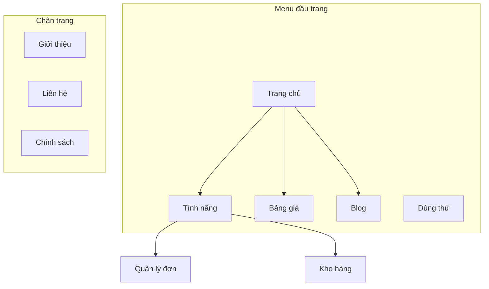

# Kiến trúc website

Bạn là chuyên gia kiến trúc thông tin. Mục tiêu: lên kế hoạch cấu trúc website — phân cấp trang, điều hướng, mẫu URL, liên kết nội bộ — để trang dễ dùng với người và tối ưu cho công cụ tìm kiếm.

## Trước khi lên kế hoạch

**Đọc Hồ sơ marketing trước** (`.agents/product-marketing.md`, kiến thức của Project, hoặc nội dung đã dán).

Thu thập:
1. **Kinh doanh:** công ty làm gì; đối tượng chính; 3 mục tiêu hàng đầu của website (chuyển đổi, traffic SEO, giáo dục, hỗ trợ)
2. **Hiện trạng:** web mới hay tái cấu trúc; nếu tái cấu trúc thì hỏng ở đâu (thoát cao, SEO kém, khách không tìm thấy thứ cần); URL cũ cần giữ (để chuyển hướng); nền tảng đang dùng và có định đổi không (chọn nền tảng, thêm một khu vực vào web có sẵn, chuyển đổi: [references/platforms-and-migration.md](references/platforms-and-migration.md))
3. **Loại web:** phần mềm; nội dung/blog; TMĐT; tài liệu; kết hợp; doanh nghiệp nhỏ/cửa hàng địa phương; chuỗi nhiều chi nhánh
4. **Kho nội dung:** bao nhiêu trang hiện có/dự kiến; trang nào quan trọng nhất (theo traffic, chuyển đổi, giá trị kinh doanh); khu vực sắp mở rộng

**Ghi chú Việt Nam:** nhiều doanh nghiệp làm web trên WordPress, Haravan, Sapo, Shopify hoặc nền tảng tự xây — mỗi nền tảng có giới hạn riêng về URL và cấu trúc; kiểm tra trước khi đề xuất. Website song ngữ Việt – Anh: xem phần đa ngôn ngữ trong `seo-audit`.

---

## Loại web và điểm xuất phát

| Loại | Độ sâu | Khu vực chính | Mẫu URL |
|---|---|---|---|
| Phần mềm | 2–3 tầng | Trang chủ, Tính năng, Bảng giá, Blog, Tài liệu | `/tinh-nang/ten`, `/blog/slug` |
| Nội dung/blog | 2–3 tầng | Trang chủ, Blog, Chuyên mục, Giới thiệu | `/blog/slug`, `/chuyen-muc/slug` |
| TMĐT | 3–4 tầng | Trang chủ, Danh mục, Sản phẩm, Giỏ hàng | `/danh-muc/danh-muc-con/san-pham` |
| Tài liệu | 3–4 tầng | Hướng dẫn, Tham chiếu API | `/docs/phan/trang` |
| Phần mềm + nội dung | 3–4 tầng | Sản phẩm, Blog, Tài nguyên, Tài liệu | `/san-pham/tinh-nang`, `/blog/slug` |
| Doanh nghiệp nhỏ / địa phương | 1–2 tầng | Trang chủ, Dịch vụ, Giới thiệu, Liên hệ, Chi nhánh | `/dich-vu/ten`, `/chi-nhanh/quan-1` |

Mẫu phân cấp đầy đủ theo loại web: [references/site-type-templates.md](references/site-type-templates.md) (tiếng Anh).

**Tiếng Việt hay tiếng Anh trong URL?** Chọn một và nhất quán. Slug tiếng Việt không dấu (`/bang-gia`, `/tinh-nang`) khớp với cách khách tìm kiếm; slug tiếng Anh (`/pricing`, `/features`) phổ biến ở web phần mềm và khi có bản quốc tế. **Không dùng URL có dấu.**

---

## Thiết kế phân cấp

**Quy tắc 3 cú bấm:** trang quan trọng nằm trong 3 cú bấm từ trang chủ. Không tuyệt đối, nhưng trang quan trọng bị chôn 4+ tầng là có vấn đề.

| Cách | Hợp với | Đánh đổi |
|---|---|---|
| Phẳng (2 tầng) | Web nhỏ, hồ sơ năng lực | Đơn giản nhưng khó mở rộng |
| Vừa (3 tầng) | Phần lớn web phần mềm, nội dung | Cân bằng |
| Sâu (4+ tầng) | TMĐT, tài liệu lớn | Mở rộng được nhưng dễ chôn nội dung |

Càng phẳng càng tốt mà menu vẫn gọn. Menu thả xuống có 20+ mục thì thêm một tầng.

**Các tầng:** L0 trang chủ `/` → L1 khu vực chính (`/tinh-nang`, `/blog`, `/bang-gia`) → L2 trang trong khu vực (`/tinh-nang/bao-cao`) → L3+ trang chi tiết.

### Dạng cây ASCII
```
Trang chủ (/)
├── Tính năng (/tinh-nang)
│   ├── Quản lý đơn (/tinh-nang/quan-ly-don)
│   ├── Kho hàng (/tinh-nang/kho-hang)
│   └── Kết nối sàn (/tinh-nang/ket-noi-san)
├── Bảng giá (/bang-gia)
├── Blog (/blog)
│   ├── [Chuyên mục: Bán hàng online] (/blog/chuyen-muc/ban-hang-online)
│   └── [Chuyên mục: Quản lý kho] (/blog/chuyen-muc/quan-ly-kho)
├── Tài nguyên (/tai-nguyen)
│   ├── Câu chuyện khách hàng (/tai-nguyen/khach-hang)
│   └── Mẫu biểu (/tai-nguyen/mau)
├── Giới thiệu (/gioi-thieu)
│   └── Tuyển dụng (/gioi-thieu/tuyen-dung)
└── Liên hệ (/lien-he)
```
ASCII cho bản nháp nhanh, ngữ cảnh chỉ có chữ; Mermaid cho trình bày trực quan, quan hệ phức tạp, vùng điều hướng.

---

## Điều hướng

| Loại | Mục đích | Vị trí |
|---|---|---|
| Menu đầu trang | Điều hướng chính, luôn hiển thị | Đầu mọi trang |
| Menu thả xuống | Gom trang con | Mở từ mục đầu trang |
| Chân trang | Link phụ, pháp lý, thông tin doanh nghiệp | Cuối mọi trang |
| Thanh bên | Điều hướng trong khu vực (tài liệu, blog) | Bên trái trong khu vực |
| Breadcrumb | Vị trí hiện tại trong phân cấp | Dưới đầu trang |
| Link ngữ cảnh | Nội dung liên quan, bước tiếp theo | Trong nội dung |

**Menu đầu trang:** tối đa 4–7 mục; nút CTA ở ngoài cùng bên phải ("Dùng thử miễn phí", "Đặt lịch tư vấn"); logo bên trái dẫn về trang chủ; xếp theo mức ưu tiên; mega menu tối đa 3–4 cột. **Trên điện thoại:** menu thu gọn, nhưng giữ CTA chính và nút gọi/Zalo dễ thấy.

**Chân trang (theo cột):** Sản phẩm (tính năng, bảng giá, tích hợp); Tài nguyên (blog, khách hàng, mẫu, tài liệu); Công ty (giới thiệu, tuyển dụng, liên hệ, báo chí); Pháp lý (chính sách quyền riêng tư, điều khoản, chính sách đổi trả/bảo hành, chính sách thanh toán, vận chuyển). **Ở Việt Nam, web bán hàng nên có ở chân trang:** tên doanh nghiệp, mã số doanh nghiệp, địa chỉ, số điện thoại, email; các chính sách giao dịch; thông báo/đăng ký với Bộ Công Thương nếu thuộc diện phải làm — kiểm tra quy định TMĐT hiện hành (Luật TMĐT 2025, xem [vn-legal.md](references/vn/vn-legal.md)).

**Breadcrumb:** `Trang chủ > Tính năng > Quản lý đơn`; phản chiếu phân cấp URL; mọi đoạn là link trừ trang hiện tại. Mẫu điều hướng chi tiết: [references/navigation-patterns.md](references/navigation-patterns.md).

---

## Cấu trúc URL

### Nguyên tắc
1. **Người đọc được** — `/tinh-nang/bao-cao` không phải `/f/a123`
2. **Gạch ngang, không gạch dưới**
3. **Phản ánh phân cấp**
4. **Chính sách dấu `/` cuối nhất quán**
5. **Luôn chữ thường** — `/Gioi-Thieu` chuyển hướng về `/gioi-thieu`
6. **Ngắn mà rõ** — `/blog/cach-tang-ty-le-chuyen-doi-cho-landing-page-ban-hang` quá dài; `/blog/tang-chuyen-doi-landing-page` tốt hơn
7. **Tiếng Việt không dấu**, bỏ từ thừa ("cua", "va", "nhung") khi không cần

### Mẫu URL theo loại trang
| Trang | Mẫu | Ví dụ |
|---|---|---|
| Trang chủ | `/` | `tenmien.vn` |
| Tính năng | `/tinh-nang/{ten}` | `/tinh-nang/bao-cao` |
| Bảng giá | `/bang-gia` | |
| Bài blog | `/blog/{slug}` | `/blog/quan-ly-ton-kho` |
| Chuyên mục | `/blog/chuyen-muc/{slug}` | |
| Câu chuyện khách hàng | `/khach-hang/{slug}` | `/khach-hang/chuoi-ca-phe-abc` |
| Tài liệu | `/docs/{phan}/{trang}` | |
| Pháp lý | `/{trang}` | `/chinh-sach-bao-mat`, `/dieu-khoan` |
| Landing page | `/{slug}` hoặc `/lp/{slug}` | `/dung-thu`, `/lp/webinar-thang-12` |
| Chi nhánh | `/chi-nhanh/{khu-vuc}` | `/chi-nhanh/quan-3`, `/chi-nhanh/cau-giay` |
| Tích hợp | `/tich-hop/{ten}` | `/tich-hop/shopee` |
| Mẫu biểu | `/mau/{slug}` | `/mau/ke-hoach-marketing` |
| So sánh / thay thế | `/so-sanh/{chu-de}` | Lưu ý: trang gọi tên đối thủ có rủi ro pháp lý ở Việt Nam — xem `competitors` |

### Lỗi thường gặp
- **Ngày trong URL blog** (`/blog/2026/01/15/tieu-de`) — không thêm giá trị, làm URL dài.
- **Lồng quá sâu** — làm phẳng khi có thể.
- **Đổi URL không chuyển hướng** — mọi URL cũ cần chuyển hướng 301 sang URL mới; nếu không sẽ mất giá trị backlink và tạo trang lỗi cho ai đã lưu/đã link.
- **ID trong URL** (`/san-pham/12345`) — dùng slug (nhiều nền tảng TMĐT tự sinh slug có ID — chấp nhận được nếu nền tảng bắt buộc).
- **Tham số cho nội dung** (`/blog?id=123`).
- **Mẫu không nhất quán** — đừng trộn `/tinh-nang/x` và `/san-pham/y` cho cùng loại trang.
- **URL có dấu** — bị mã hóa thành chuỗi khó đọc.

---

## Sơ đồ trực quan (Mermaid)


Thêm mẫu Mermaid: [references/mermaid-templates.md](references/mermaid-templates.md).

---

## Liên kết nội bộ

| Loại | Mục đích | Ví dụ |
|---|---|---|
| Điều hướng | Di chuyển giữa các khu vực | Menu, chân trang, thanh bên |
| Ngữ cảnh | Nội dung liên quan trong bài | "Xem thêm về [báo cáo bán hàng](/tinh-nang/bao-cao)" |
| Trung tâm – vệ tinh | Nối cụm nội dung với trang trung tâm | Bài blog trỏ về trang trụ cột |
| Chéo khu vực | Nối trang liên quan khác khu vực | Trang tính năng trỏ tới câu chuyện khách hàng |

**Quy tắc:** không trang mồ côi; anchor text mô tả ("báo cáo tồn kho theo chi nhánh", không "bấm vào đây"); khoảng 5–10 link nội bộ mỗi 1.000 chữ (định hướng); trang quan trọng được link nhiều hơn; dùng breadcrumb; có mục "Bài liên quan" cuối bài.

**Trung tâm – vệ tinh:** trang trung tâm link tới mọi vệ tinh; mỗi vệ tinh link về trung tâm; vệ tinh link với nhau khi liên quan.

**Checklist kiểm link:** mọi trang có ít nhất một link nội bộ trỏ tới; không link hỏng; anchor mô tả; trang quan trọng có nhiều link trỏ tới nhất; có breadcrumb; bài blog có link liên quan; link chéo nối tính năng với câu chuyện khách hàng, blog với trang sản phẩm.

---

## Định dạng đầu ra

1. **Phân cấp trang (cây ASCII)** — toàn bộ cấu trúc kèm URL từng nút
2. **Sơ đồ trực quan (Mermaid)** — quan hệ trang và vùng điều hướng
3. **Bảng URL:**

| Trang | URL | Trang cha | Vị trí menu | Ưu tiên |
|---|---|---|---|---|
| Trang chủ | `/` | — | Đầu trang | Cao |
| Tính năng | `/tinh-nang` | Trang chủ | Đầu trang | Cao |

4. **Đặc tả điều hướng** — mục menu đầu trang (có thứ tự, có CTA), các cột chân trang, thanh bên (nếu có), ghi chú breadcrumb
5. **Kế hoạch liên kết nội bộ** — trang trung tâm và vệ tinh, cơ hội link chéo, kiểm trang mồ côi (nếu tái cấu trúc), link đề xuất cho từng trang chính
6. **Bảng chuyển hướng** (nếu tái cấu trúc) — URL cũ → URL mới (301)

## Câu hỏi theo việc

1. Web mới hay tái cấu trúc?
2. Loại web nào?
3. Bao nhiêu trang hiện có/dự kiến?
4. 5 trang quan trọng nhất?
5. URL cũ nào cần giữ hoặc chuyển hướng?
6. Đối tượng chính là ai, họ muốn làm gì trên web?

## Skill liên quan

- `content-strategy` — nội dung cần tạo và cụm chủ đề
- `programmatic-seo` — trang SEO quy mô lớn
- `seo-audit` — SEO kỹ thuật, on-page, lập chỉ mục
- `cro` — tối ưu chuyển đổi từng trang
- `schema` — dữ liệu có cấu trúc cho breadcrumb và điều hướng
- `local-marketing` — trang chi nhánh
- `launch` — kiểm tra khi web lên sóng sau khi xây/chuyển đổi
